<div align="center">

<!-- ======================================================== -->
<!-- 1. LIVE ANIMATED CONTRIBUTION HEATMAP                     -->
<!-- Auto-refreshed daily via GitHub Actions (.github/...)     -->
<!-- ======================================================== -->

<h3><code>aagam@github ~ $ ./contributions.sh</code></h3>



<br>
<br>

<!-- ======================================================== -->
<!-- 2. ASCII PORTRAIT (LEFT) + REAL-TIME STATS CARD (RIGHT)   -->
<!-- Self-contained SMIL/CSS animated SVGs (840x880 aligned)   -->
<!-- ======================================================== -->

<h3><code>aagam@github ~ $ whoami</code></h3>

<table>
  <tr>
    <td valign="top"></td>
    <td valign="top"></td>
  </tr>
</table>

<br>
<br>

<!-- ======================================================== -->
<!-- 3. CYPHER QUERY // SIGNATURE PROFILE                      -->
<!-- ======================================================== -->

<h3><code>aagam@github ~ $ ./cypher-query.sh</code></h3>

<p><b>AI Engineer · Graph Intelligence · Multi-Agent &amp; Production RAG Systems</b></p>
<p>DJSCE Mumbai — B.Tech AI &amp; Data Science &nbsp;·&nbsp; AI Intern @ PearlThoughts</p>

```cypher
MATCH (dev:Engineer {name: "Aagam Mehta"})-[:SPECIALIZES_IN]->(core)
RETURN dev.role, dev.status, core.knowledge_graphs, core.agentic_systems
```

<br>

<!-- ======================================================== -->
<!-- 4. CORE TECH STACK                                        -->
<!-- ======================================================== -->

<h3><code>aagam@github ~ $ ./stack.sh</code></h3>

<p>
  
  
  
  
  
  
  
  
  
  
</p>

<br>

<!-- ======================================================== -->
<!-- 5. CONNECT & STATUS                                       -->
<!-- ======================================================== -->

<h3><code>aagam@github ~ $ ./links.sh</code></h3>

[](https://linkedin.com/in/aagam-mehta)
[](mailto:Aagambot372@gmail.com)
[](https://github.com/Aagambot)

<br><br>

```text
> STATUS: [ONLINE] — Open to Freelance Projects | AI/ML Internships | Full-Time Roles
> LOCATION: Mumbai, India · UTC+5:30
```

<br>

</div>
